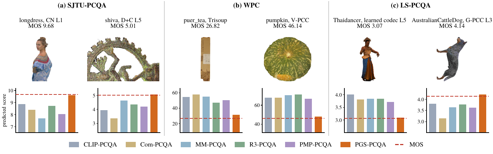
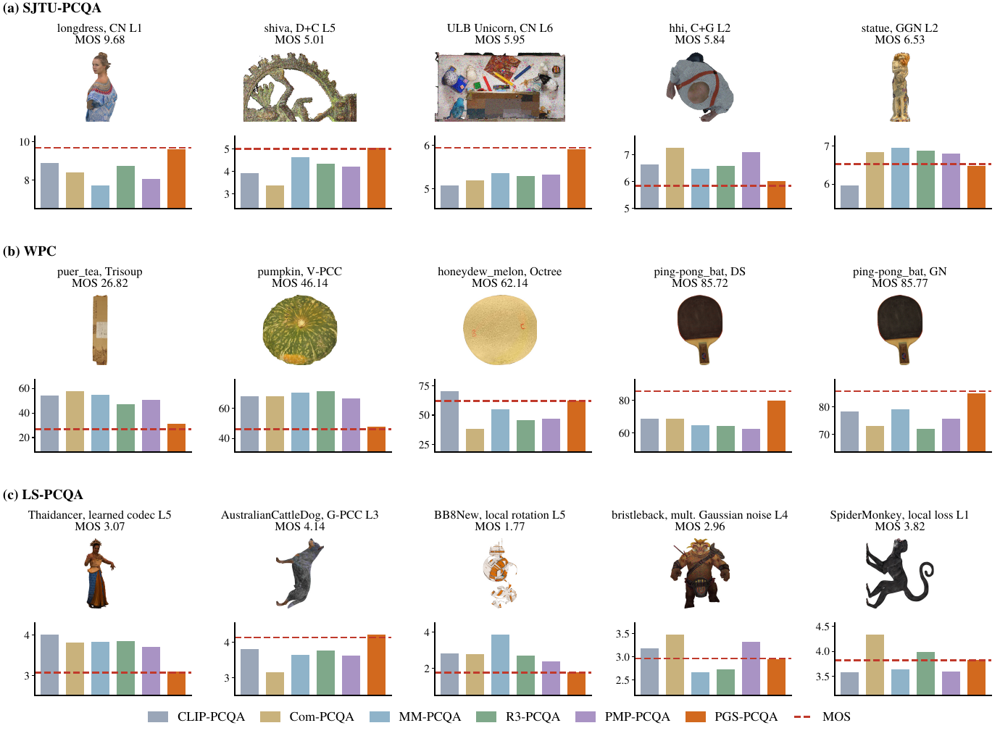

# PGS-PCQA

Code for **PGS-PCQA**, a no-reference point cloud quality assessment (NR-PCQA) model trained with perceptually gated synthetic supervision.

## Qualitative results

Predicted scores on SJTU-PCQA, WPC and LS-PCQA, mapped to the MOS scale; the red dashed line is the MOS (closer is better).





## Contents

```
pgs_pcqa/          model and test code (CLIP-PCQA backbone, KPA branch), split files
tools/             projection rendering, KPA inputs, checkpoint evaluation
bank/              synthetic distortion bank and perceptual distance
data/banks/        bank sample lists and perceptual distances
scripts/           evaluation scripts
predictions/       per-sample predictions of the reported results
reproduce_tables.py
```

## Environment

```
conda env create -f environment.yml
conda activate pgs_pcqa
```

## Evaluation

```
# cross-dataset
bash scripts/eval_cross.sh <source DB> <checkpoint.pth> <out_dir> <target DB> ...
# intra-dataset (k-fold checkpoints)
bash scripts/eval_intra.sh <DB> <ckpt_dir> fg4x4
```

## Reproduce the tables

```
python reproduce_tables.py
```

Recomputes the reported PGS-PCQA results from `predictions/` (CPU only, no datasets needed).

Pretrained weights will be released after review.

## License

[MIT](LICENSE). The bundled CLIP implementation (`pgs_pcqa/clip/`) is from OpenAI and is also MIT-licensed.
